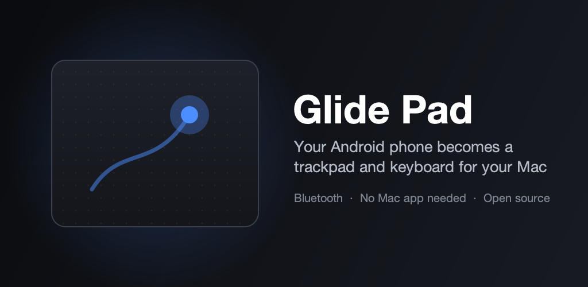
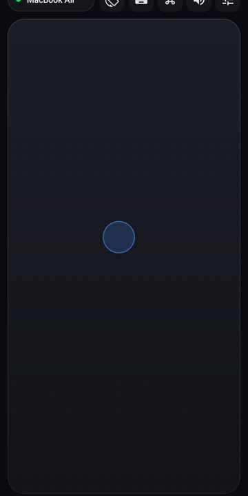
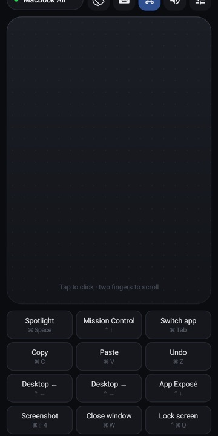
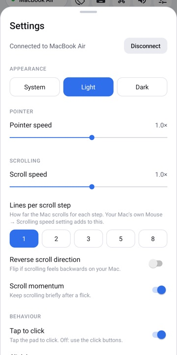
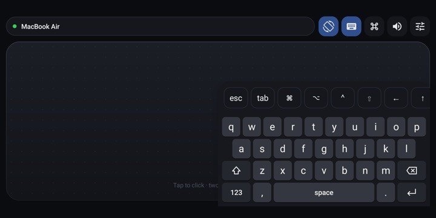
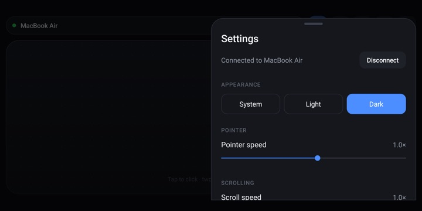

<p align="center"></p>

# Glide Pad

[](https://github.com/Neerajreddyapi/GlidePad/actions/workflows/build.yml)
[](https://play.google.com/store/apps/details?id=com.neerajreddy.glidepad)
[](LICENSE)


Turn your Android phone into a Bluetooth trackpad and keyboard for your Mac, Windows PC, Chromebook, iPad, Linux computer or smart TV. There is nothing to install on the other device: it simply sees a Bluetooth keyboard and mouse.

<p>
  
  
  
</p>
<p>
  
  
</p>

## Features

- **Trackpad:** move the pointer with pointer acceleration, tap to click, double-tap to double-click, press and hold then move to drag.
- **Two-finger gestures:** two-finger tap to right-click, two-finger scroll in any direction with momentum, and pinch to zoom (⌘+ / ⌘−).
- **Works with your device:** pick Mac, Windows PC, Chromebook, iPad, Linux, Smart TV or Other, and Glide Pad sets up the right shortcuts, gestures, zoom keys and key names.
- **Four-finger gestures** (Mac and Windows): Mission Control / Task View, App Exposé / show desktop, switching desktops, and spread to show the desktop.
- **Keyboard:** type with your phone's keyboard in portrait, or with a built-in keyboard in landscape that leaves half the trackpad free. A key row adds esc, tab, arrows and ⌘ ⌥ ⌃ ⇧.
- **Shortcuts:** one tap for the everyday shortcuts of your device (Spotlight or Start, app switcher, copy, paste, undo, screenshot, lock screen and more), or a remote-style panel for TVs.
- **Media keys:** play/pause, next, previous, volume and mute.
- **Landscape mode:** a wide, full-screen trackpad. Panels and settings slide up on the right half.
- **Stays connected:** keeps the Mac connected while you switch apps, and reconnects to your last Mac when you open the app.
- **Make it yours:** pointer speed, scroll speed, lines per scroll step, reverse scrolling, momentum, tap to click, optional click buttons, haptics, and light or dark mode.
- **Private:** no internet permission, no accounts, no ads, no tracking.

## Getting started

1. Install Glide Pad from [Google Play](https://play.google.com/store/apps/details?id=com.neerajreddy.glidepad). It's in closed testing now, with the public launch coming soon. Glide Pad is only distributed through Google Play; to build it yourself, see the [development setup](#development-setup).
2. Open Glide Pad, allow Bluetooth, and tap **Make phone visible**.
3. Choose what you're connecting to, then follow the steps on screen. On a Mac, for example: **System Settings → Bluetooth**, click **Connect** next to your phone, and accept the code on both screens. On Windows: **Settings → Bluetooth & devices → Add device → Bluetooth**.

Paired the phone with the Mac before? Remove it on both devices first, then pair again so the Mac sees it as a keyboard and mouse.

## Good to know

- **Three and four-finger gestures may not work on every phone.** Many phones (OnePlus and others) use multi-finger swipes for their own features, such as screenshots, and Android doesn't let apps override that. Glide Pad leaves three fingers to your phone. If four-finger swipes don't reach your Mac, the ⌘ shortcuts panel does the same things.
- **Scrolling moves in steps,** like a mouse wheel. Only Apple's own trackpads can do pixel-smooth scrolling and real Mac gestures, because they use a private protocol.
- **Phone support:** you need Android 9 or newer. A few phone makers turn off Android's "Bluetooth keyboard and mouse" mode, and only one app can use it at a time.
- **Which devices:** anything that supports Bluetooth keyboards and mice: Macs, Windows PCs, Chromebooks, iPads, Linux computers and most smart TVs. A regular monitor only shows a picture, so connect to the computer it's plugged into instead.

## How it works

Android 9 added [`BluetoothHidDevice`](https://developer.android.com/reference/android/bluetooth/BluetoothHidDevice), which lets a phone act as a Bluetooth HID device. Glide Pad registers one combined device with three reports: a mouse (5 buttons, 16-bit X/Y, wheel and horizontal pan), a keyboard and media keys. Gestures that a mouse can't express are sent as the matching keyboard shortcuts for the chosen device (for example ⌃↑ for Mission Control on a Mac, Win+Tab for Task View on Windows).

| File | What it does |
|---|---|
| [`HidManager.java`](app/src/main/java/com/glidepad/app/HidManager.java) | HID descriptor, Bluetooth registration and connection, sending reports |
| [`TrackpadView.java`](app/src/main/java/com/glidepad/app/TrackpadView.java) | The touch surface and gesture recognition |
| [`MacKeyboardView.java`](app/src/main/java/com/glidepad/app/MacKeyboardView.java) | The built-in landscape keyboard |
| [`HidService.java`](app/src/main/java/com/glidepad/app/HidService.java) | Foreground service that keeps the Mac connected in the background |
| [`MainActivity.java`](app/src/main/java/com/glidepad/app/MainActivity.java) | Screens, panels, settings, pairing and the device picker |
| [`Platform.java`](app/src/main/java/com/glidepad/app/Platform.java) | Per-device shortcuts, gestures, zoom keys, key names and pairing steps |

## Development setup

Want to change Glide Pad or build it yourself? Here's how to set up your environment.

1. **Install [Android Studio](https://developer.android.com/studio).** It includes the Android SDK and a bundled JDK. In *SDK Manager*, make sure **Android SDK Platform 36** is installed (the app compiles against API 36 and runs on Android 9.0+). There are no third-party libraries to install.
2. **Clone the repo:**
   ```sh
   git clone https://github.com/Neerajreddyapi/GlidePad.git
   cd GlidePad
   ```
3. **Open it in Android Studio** (*File → Open* → the `GlidePad` folder) and let Gradle sync. Android Studio creates `local.properties` with your SDK path for you.
4. **Run it on a real phone:** turn on USB debugging, plug the phone in, pick it as the target and press **Run ▶**. Or, from the terminal:
   ```sh
   # macOS: use Android Studio's bundled JDK
   export JAVA_HOME="/Applications/Android Studio.app/Contents/jbr/Contents/Home"
   ./gradlew installDebug
   ```
   If Glide Pad from Google Play is already installed, uninstall it first. Android won't install a build signed with a different key over it.
5. **Connect to a computer:** open the app, tap **Make phone visible**, then connect from the computer's Bluetooth settings.

**Phone, not emulator:** the Android emulator can show the screens, but it can't act as a Bluetooth keyboard and mouse for a real computer. Test anything about connecting, gestures or typing on a phone.

**Where to make changes**

- **Gestures and the trackpad surface:** [`TrackpadView.java`](app/src/main/java/com/glidepad/app/TrackpadView.java). Speeds and thresholds are the constants at the top.
- **Bluetooth, the HID descriptor and what gets sent to the computer:** [`HidManager.java`](app/src/main/java/com/glidepad/app/HidManager.java). Key codes and Mac shortcuts are in [`Keys.java`](app/src/main/java/com/glidepad/app/Keys.java).
- **Screens, panels, settings and pairing:** [`MainActivity.java`](app/src/main/java/com/glidepad/app/MainActivity.java) and [`activity_main.xml`](app/src/main/res/layout/activity_main.xml).
- **The landscape keyboard:** [`MacKeyboardView.java`](app/src/main/java/com/glidepad/app/MacKeyboardView.java).
- **Colours:** [`values/colors.xml`](app/src/main/res/values/colors.xml) (light) and [`values-night/colors.xml`](app/src/main/res/values-night/colors.xml) (dark).
- **Website and privacy policy:** [`docs/`](docs), published with GitHub Pages.

**Logs:** Android's Bluetooth HID service and any crashes show up in logcat:
```sh
adb logcat -s HidDeviceService AndroidRuntime
```

**Release builds:**
```sh
./gradlew assembleRelease   # APK  -> app/build/outputs/apk/release/
./gradlew bundleRelease     # AAB  -> app/build/outputs/bundle/release/
```

Release signing reads `keystore.properties` from the repo root (not committed):

```properties
storeFile=your-upload-key.jks
storePassword=...
keyAlias=upload
keyPassword=...
```

Without that file, release builds are signed with the debug key so a fresh clone still builds and installs.

## Contributing

Contributions are welcome: bug reports, device test results, ideas and pull requests. Set up your environment with the [development setup](#development-setup) above, then read the [contributing guide](CONTRIBUTING.md) for how to test on a real phone and open a pull request. Changes are listed in the [changelog](CHANGELOG.md). Everyone taking part follows the [code of conduct](CODE_OF_CONDUCT.md). Found a security problem? See the [security policy](SECURITY.md).

## Privacy

Glide Pad collects nothing. Read the [privacy policy](https://neerajreddyapi.github.io/GlidePad/privacy-policy.html).

## License

[MIT](LICENSE) © 2026 Neeraj Reddy.
